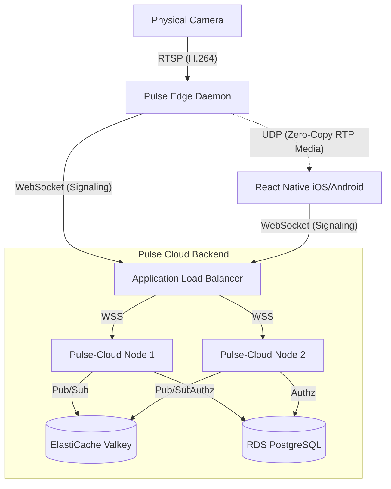

# Pulse WebRTC Ecosystem

Welcome to the Pulse WebRTC ecosystem! Pulse is a highly-scalable, zero-copy, hardware-accelerated video streaming platform designed to route massive volumes of home security camera footage securely to mobile devices with sub-100ms latency.

## 🏗️ System Architecture

Pulse bypasses traditional media servers (like Kurento or Janus) by implementing a custom **Valkey-backed SDP routing hub** and a **Zero-Copy Edge Daemon**.



## 🚀 Key Features

1. **Zero-Copy WebRTC**: The Edge Daemon (`hss`) ingests RTSP and wraps the raw H.264 NALUs directly into RTP packets without transcoding.
2. **Horizontal Scaling**: The Cloud Backend (`pulse-cloud`) doesn't route video. It routes WebRTC Session Descriptions (SDPs) via a Valkey Pub/Sub fabric. You can scale the cloud infinitely to handle millions of connections.
3. **Ed25519 Security**: Devices authenticate using Ed25519 asymmetric cryptography. `pulse-cloud` queries PostgreSQL to guarantee that a user can only route WebRTC offers to cameras they explicitly own.
4. **Adaptive Bitrate (ABR)**: The Edge Daemon intercepts RTCP PLI/REMB feedback from mobile phones and dynamically switches to lower-quality substreams during 5G network congestion.

## 🛠️ Local Development & Testing

This repository contains a massive suite of Unit, Integration, Load, Chaos, and Security tests. 

**Requirements:**
- Go 1.21+
- Docker & Docker Compose
- Node.js (for React Native)

### 1. Run the Ephemeral Test Environment
To test the cloud routing logic locally without breaking production databases:
```bash
cd hss-phase1a
docker-compose -f docker-compose.test.yml up -d
```
This spins up PostgreSQL on port `5433` and Valkey on port `6380`.

### 2. Run the Test Suites
```bash
# Run End-to-End WebSocket -> Valkey -> WebSocket Integration Tests
go test ./tests/integration_test.go -v

# Run the Ed25519 Authz Security Penetration Tests
go test ./tests/security_test.go -v

# Run the Chaos Engineering Network Drop Tests
go test ./tests/chaos_test.go -v

# Run the Headless Pion WebRTC E2E Media UDP Tests
go test ./tests/e2e_media_test.go -v
```

### 3. Run the Viral Load Tester
To benchmark the Valkey routing throughput on your local machine:
```bash
go run ./cmd/stress-tester --edges=100 --viewers=1000
```

## 📱 Mobile App Development
The iOS/Android application is located in `pulse-mobile/`. It utilizes `react-native-webrtc` to bind directly to the hardware GPU for decoding, bypassing the JavaScript bridge.

```bash
cd pulse-mobile
npm install
npx expo prebuild # Generates native iOS/Android directories
npx expo run:ios  # Compiles and runs the native app
```

## ☁️ Deployment (AWS Terraform)
Infrastructure as Code is located in `deploy/terraform`.
```bash
cd hss-phase1a/deploy/terraform
terraform init
terraform apply
```
This will automatically provision the VPC, RDS, ElastiCache, and an ECS Fargate cluster behind an ALB.
